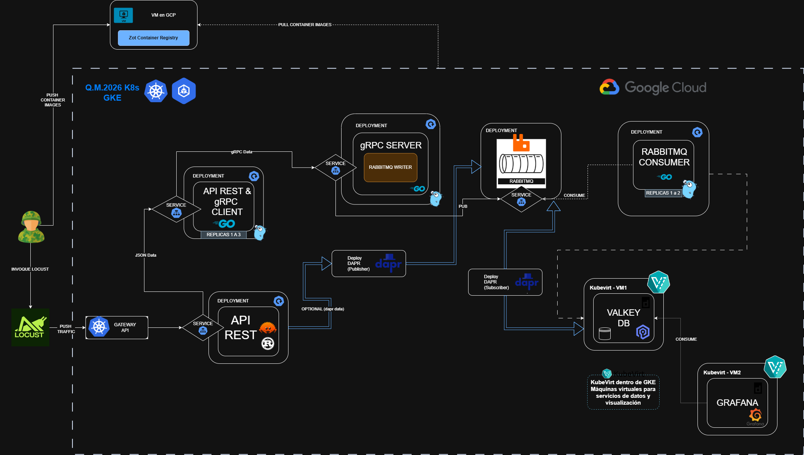
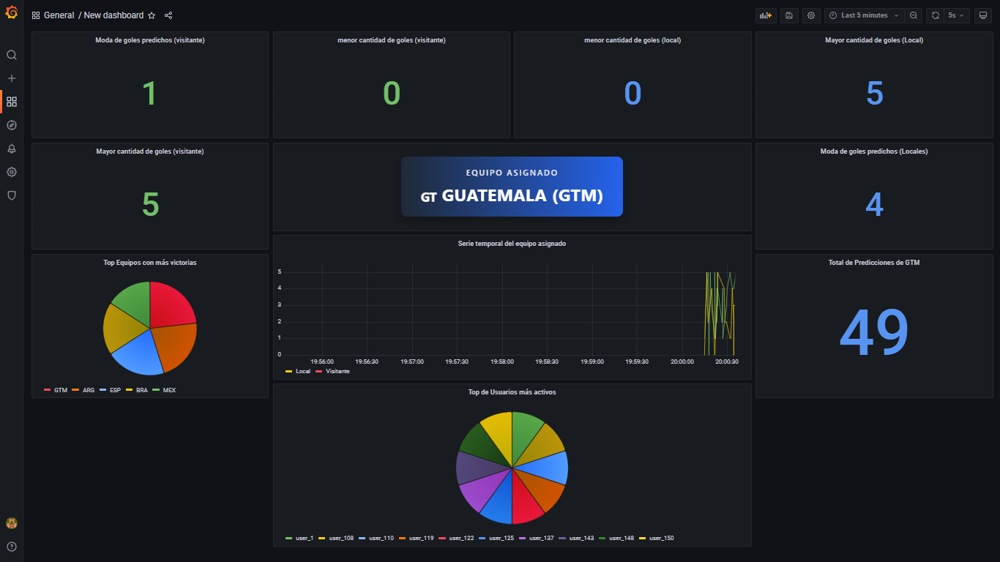
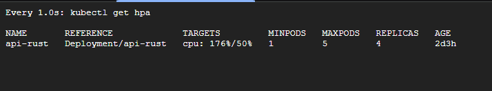
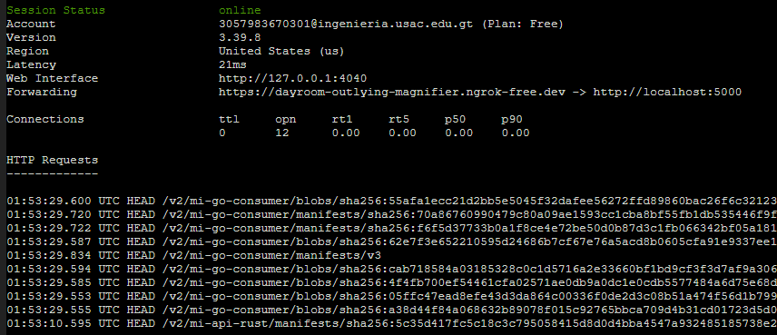
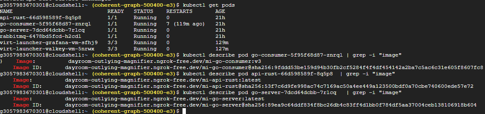
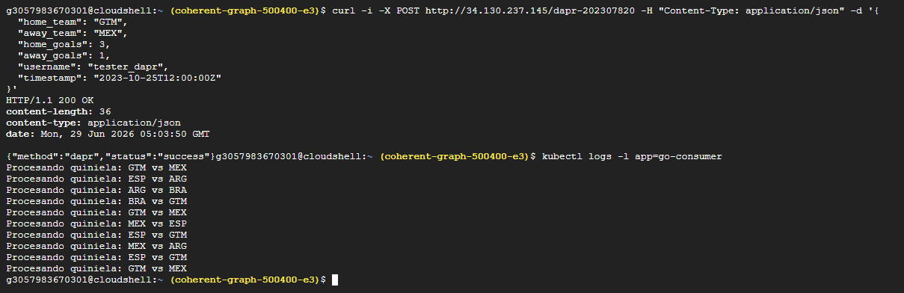

# Manual Técnico - Sistema de Gestión de Quinielas Deportivas


## 1. Arquitectura General

El sistema está diseñado bajo una arquitectura de microservicios orientada a eventos, garantizando alta disponibilidad y tolerancia a fallos. Los componentes se ejecutan en contenedores gestionados por `containerd` sobre máquinas virtuales provisionadas con KubeVirt. 

La arquitectura se compone de los siguientes elementos:
* **API Gateway (Rust):** Punto de entrada que recibe peticiones HTTP REST de los clientes.
* **Servidor gRPC (Go):** Intermediario que recibe datos del Gateway y publica mensajes en la cola.
* **Message Broker (RabbitMQ):** Gestor de colas asíncronas para desacoplar la ingesta del procesamiento.
* **Worker/Consumidor (Go):** Servicio en segundo plano que procesa los mensajes de RabbitMQ y calcula métricas.
* **Base de Datos en Memoria (Valkey):** Almacenamiento rápido para contadores, rangos y streams de datos.
* **Visualización (Grafana):** Tableros para el monitoreo de métricas almacenadas en Valkey.



---

## 2. Flujo Completo de Datos
El ciclo de vida de un dato dentro del clúster sigue este flujo exacto:

1. **Generación de Tráfico:** El cliente Locust genera miles de predicciones en formato JSON y las envía vía HTTP POST hacia la IP pública del Gateway.

2. **Recepción REST:** El Gateway API enruta la petición hacia el pod de la API en Rust.

3. **Traducción a gRPC:** Rust recibe el JSON, lo serializa en un mensaje de Protocol Buffers (`Protobuf`) y lo envía a través de una conexión gRPC de alta velocidad hacia el Servidor Go.

4. **Encolamiento:** El Servidor Go actúa como publicador (`Producer`) y coloca el mensaje en una cola de RabbitMQ.

5. **Consumo Asíncrono:** El Worker en Go (Consumidor) extrae los mensajes de la cola uno por uno (o en lotes).

6. **Almacenamiento:** El Worker guarda los datos de la quiniela en la base de datos en memoria Valkey.

7. **Visualización:** Grafana se conecta directamente a Valkey para consultar las estadísticas en tiempo real y mostrarlas en dashboards interactivos.


---

## 3. Configuración de Gateway API (Rust)

Para exponer el sistema hacia internet de forma segura y eficiente, se implementó un Gateway API (Ingress) respaldado por un balanceador de carga de Google Cloud (LoadBalancer).
Esta configuración permite mapear la IP pública externa hacia el servicio interno de la API de Rust, aislando el resto de los componentes del clúster (RabbitMQ, Go, Valkey) para que no sean accesibles desde el exterior, garantizando así la seguridad de la red interna de Kubernetes.

---

## 4. Comunicación REST y gRPC

El sistema implementa dos paradigmas de comunicación de red:

* REST (Síncrono/Externo): Utilizado entre los clientes (Locust) y la API de Rust. Facilita la ingesta de datos estándar en formato JSON sobre HTTP/1.1.

* gRPC (Síncrono/Interno): Utilizado entre Rust y el Servidor Go. Al usar HTTP/2 y Protobuf, los mensajes se envían en formato binario, reduciendo drásticamente la latencia y el tamaño del payload, ideal para la comunicación interna de alto rendimiento en el clúster.

---

## 5. Uso de RabbitMQ

Para evitar que la base de datos colapse bajo picos de tráfico masivo (Miles de requests por segundo de Locust), se integró RabbitMQ como un Message Broker. Actúa como un amortiguador (buffer): el Servidor Go simplemente "suelta" los mensajes en la cola y queda libre para recibir más peticiones instantáneamente. El Consumidor Go se encarga de procesarlos al ritmo que la base de datos (Valkey) pueda soportar, garantizando cero pérdida de datos.

---

## 6. Despliegue de Valkey y Grafana (containerd en KubeVirt)

Uno de los hitos técnicos del proyecto fue la implementación de KubeVirt. En lugar de usar pods tradicionales de Kubernetes, se aprovisionaron Máquinas Virtuales (VMs) reales dentro de los nodos del clúster.
Dentro de estas VMs administradas por KubeVirt, se instaló el motor de contenedores `containerd` para ejecutar:

* Valkey: Base de datos NoSQL de alta velocidad en memoria, garantizando persistencia de la quiniela.

* Grafana: Herramienta de visualización de datos.
Esta arquitectura demuestra la capacidad de Kubernetes para orquestar infraestructuras híbridas (Contenedores + VMs) en un mismo plano de control.



---

## 7. Configuración de HPA (Horizontal Pod Autoscaler)

Para garantizar la disponibilidad ante tráfico agresivo, se configuró un Horizontal Pod Autoscaler (HPA) sobre el Deployment de la API de Rust.
El HPA monitorea el consumo de CPU mediante el Metrics Server. Se estableció un límite crítico del 50% de CPU.

Evidencia de Autoescalado: Durante el ataque de carga con Locust, el pod principal de Rust alcanzó un pico de saturación del 116% de CPU. El HPA reaccionó automáticamente aprovisionando nuevos recursos y escalando el deployment de 1 a 3 réplicas, distribuyendo la carga exitosamente.



---

## 8. Publicación y Consumo de Imágenes desde Zot

Como mecanismo de seguridad y soberanía de código, se implementó un registro de contenedores privado llamado Zot en una VM independiente.
Para superar la restricción nativa de Google Kubernetes Engine (GKE) que exige certificados SSL (HTTPS) para extraer imágenes, se implementó un Túnel Inverso (Ngrok) hacia el puerto 5000 de Zot.

Esto permitió a GKE validar el certificado de seguridad temporal, descargar las imágenes empaquetadas desde el registro privado e instanciar los pods de la aplicación correctamente, demostrando un dominio avanzado de redes y troubleshooting en la nube.




---

## 9. Guía de Reproducibilidad / Ejecución

Para replicar este proyecto desde cero, siga los siguientes pasos:

1. **Configuración de la Infraestructura en la Nube:**

    * Crear un clúster estándar en Google Kubernetes Engine (GKE).

    * Crear una VM independiente para alojar Zot Container Registry.

2. **Registro Privado Zot:**

    * Levantar Zot en la VM en el puerto 5000.

    * Ejecutar Ngrok en la VM para exponer el puerto 5000 a internet de forma segura (ngrok http 5000).

    * Hacer build y push de las imágenes de Docker (mi-api-rust, mi-go-server, mi-go-consumer) apuntando a la URL generada por Ngrok. 

3.  **Despliegue de Servicios Core:**

    * Actualizar el archivo apps.yaml con la nueva URL de Ngrok y aplicar configuraciones en GKE en la cual apps.yaml puede tener la siguiente forma:
    ```bash
    kubectl apply -f apps.yaml
    kubectl apply -f dapr-rabbitmq.yaml
    kubectl apply -f gateway.yaml
    kubectl apply -f grafana-vm-perfecto.yaml
    kubectl apply -f rabbitmq.yaml
    kubectl apply -f valkey-vm.yaml
    ```
    * Aplicar el autoscaler:
    ```bash
    kubectl autoscale deployment api-rust --cpu=50% --min=1 --max=5
    ```
4.  **Despliegue KubeVirt:**
    Aplicar los yamls correspondientes para instanciar las VMs de Valkey y Grafana dentro del clúster.

5. **Pruebas de Carga:**
    * Instalar entorno Python y Locust en la máquina local.

    * Apuntar el archivo locustfile.py a la IP pública del Gateway de GKE.

    * Ejecutar la prueba:
    ```bash
    locust -f locustfile.py
    ```

---

## 10. Pruebas Realizadas y Conclusiones

Se realizaron pruebas de carga y estrés utilizando Locust. Se comparó el comportamiento del flujo completo variando el número de réplicas en los servicios de Go (Procesamiento interno) para medir la capacidad de vaciado de colas.

|Escenario| Tasa de Ingesta (Locust)|Tiempos de Respuesta|Observación en RabbitMQ / Sistema|
|----|-----|-----|-----|
|**1 Réplica (Go Server y Consumer)**| [Ej: 50 RPS] | [Ej: Media 150ms] | [Ej: La cola de RabbitMQ crecía rápidamente ya que 1 solo worker no se daba abasto. Grafana tardaba más en graficar todos los puntos.] |
| **2 Réplicas (Go Server y Consumer)** | [Ej: 50 RPS] | [Ej: Media 80ms] | [Ej: La cola se mantuvo estable. Los dos workers procesaron los mensajes el doble de rápido, reflejándose en Grafana casi en tiempo real.] |

### Conclusiones:

1. **El cuello de botella no es la API web:** Rust demostró ser extremadamente ligero. El verdadero cuello de botella en cargas masivas se ubica en el procesamiento posterior (Worker y Base de datos).

2. **Escalado estratégico:** Aumentar las réplicas de procesamiento interno (Workers) reduce drásticamente el tamaño de la cola de RabbitMQ, demostrando que en microservicios, se debe escalar la capa que procesa datos pesados, no solo la que los recibe.

3. **Resiliencia de Arquitectura:** El uso combinado de RabbitMQ como amortiguador y el HPA de Kubernetes asegura que el sistema nunca colapse perdiendo datos (Fails: 0 en Locust), sin importar la cantidad de solicitudes simultáneas.


### Implementación de DAPR
1. **Integración y Arquitectura del SDK de Dapr**

Para integrar Dapr en la arquitectura existente, se utilizó el patrón Sidecar. Mediante anotaciones específicas en el manifiesto de despliegue (apps.yaml), Kubernetes inyectó un contenedor secundario (sidecar de Dapr) en el pod de la API en Rust.

Esto permitió abstraer la complejidad de la infraestructura. La API en Rust ya no necesita conocer las credenciales de RabbitMQ ni importar librerías complejas (como AMQP); en su lugar, se comunica a través de peticiones HTTP estándar directamente a su sidecar local (localhost:3500).

2. **Envío de información mediante Pub/Sub (Publicador)**

En la API de Rust, se creó la ruta /dapr-202307820. Cuando una petición de Locust ingresa por esta ruta, el microservicio actúa como Publicador.
Se utilizó la librería reqwest para enviar el payload JSON directamente al endpoint de publicación de Dapr:
http://localhost:3500/v1.0/publish/rabbitmq-pubsub/quinielas?metadata.rawPayload=true

El parámetro rawPayload=true fue crucial para enviar el JSON en su formato original sin envolverlo en el estándar CloudEvents, garantizando la compatibilidad con el consumidor.

3. **La comunicación desacoplada a través de RabbitMQ**

Para conectar Dapr con RabbitMQ, se configuró un Componente de tipo pubsub.rabbitmq (dapr-rabbitmq.yaml). Dapr, actuando como intermediario, recibe el mensaje HTTP de Rust y lo publica en un Exchange de tipo Fanout dentro de RabbitMQ.

Esto logra un desacoplamiento total: el publicador (Rust) no sabe quién, cómo, ni cuándo se procesará el mensaje. Simplemente confía en que Dapr entregará la información al Broker.

4. **Recepción de información mediante suscripción a eventos (Suscriptor)**

El microservicio Go Consumer actúa como Suscriptor. Para recibir los eventos generados por Dapr, el código en Go fue adaptado para:

1. Declarar explícitamente la cola quinielas (configurada como durable: true para mantener compatibilidad con el flujo gRPC).

2. Declarar el Exchange quinielas (configurado como durable: false para coincidir con la configuración del componente de Dapr).

3. Vincular (Bind) la cola al Exchange.

Gracias a esto, cualquier evento publicado por Dapr en el Exchange es automáticamente enrutado a la cola, donde el consumidor lo extrae de forma asíncrona, lo procesa y lo inserta en la base de datos Valkey.

